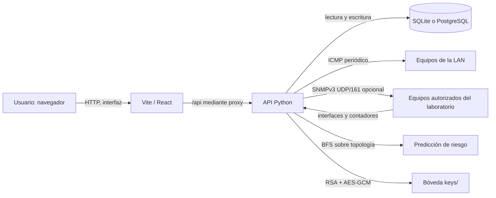

# Manual de instalación y despliegue — NetGuard AI

## 1. Información general

| Dato | Información |
|---|---|
| Nombre del proyecto | NetGuardAI |
| Nombre del sistema | NetGuard AI |
| Integrantes | Lipa Lipa Luis Angel; Rodriguez Zea Cristhian Jesus; Morales Cárdenas Eduardo Gabriel; Anco Sandoval Alejandro Augusto; Loayza Mendoza Farid Jharen |
| Curso y sección | COMPUTACIÓN EN RED III – Sección B |
| Fecha de elaboración | 26 de noviembre de 2026 |
| Versión | 1.0.0 |
| Repositorio GitHub | https://github.com/Janooooo0/NetGuardAI |

## 2. Descripción técnica de la solución

NetGuard AI es un prototipo local de monitoreo de red empresarial. El archivo
`laptop.csv` (o la ruta indicada en `NETGUARD_INVENTORY`) es la fuente única de
dispositivos que aparecen en el dashboard. El sistema solo presenta métricas,
alertas, degradaciones y predicciones que ya estén guardadas en la base de
datos; no genera datos ficticios. El monitor ICMP y el recolector SNMPv3
realizan mediciones reales sobre los equipos configurados.

El flujo principal es:

```text
Inventario CSV → recolección ICMP / SNMPv3 → base de datos → detección de anomalías
   → análisis de degradación → evento de riesgo → predicción por topología
   → alerta e historial
```

La aplicación tiene estos componentes:

- **Frontend:** interfaz de usuario en React, compilada y servida durante el
  desarrollo por Vite.
- **API:** servidor HTTP en Python que entrega el dashboard, consultas SNMPv3,
  mediciones ICMP periódicas y comprobaciones puntuales de exposición TCP.
- **Persistencia:** SQLite local por defecto. El backend también contempla
  PostgreSQL si se configura `DATABASE_URL` y se instala su driver.
- **Recolector SNMPv3 opcional:** consulta manualmente uno o más equipos
  privados autorizados del laboratorio. No requiere instalar un agente en esos
  equipos, pero tampoco realiza descubrimiento ni escaneo de laptops o de la
  red. Con las lecturas de tráfico calcula el **Network Risk Index**.
- **Monitor ICMP opcional:** envía cinco solicitudes de ping al destino privado
  asociado a cada equipo y guarda latencia, pérdida y disponibilidad. Funciona
  con la salida de `ping` de Windows (en español o inglés) y de Linux.
- **Predicción por topología:** cuando se registra un evento de riesgo, recorre
  la topología construida con la columna `uplink` del inventario mediante
  búsqueda en anchura (BFS), hasta tres saltos, y marca equipos
  *potencialmente afectados*. No confirma compromisos.
- **Bóveda de credenciales:** cifra las claves SNMPv3 en reposo con RSA-2048
  (OAEP/SHA-256) y AES-256-GCM. Los valores cifrados se guardan con el prefijo
  `enc:v1:`.
- **Comprobación de exposición:** revisa puertos conocidos de una sola IPv4
  privada por solicitud y requiere confirmar autorización. No explota servicios
  ni confirma vulnerabilidades o versiones.

### Diagrama de arquitectura



En desarrollo, el navegador abre el frontend en `127.0.0.1:5173` normalmente.
El proxy de Vite reenvía `/api` a la API Python, que escucha en `127.0.0.1` y
elige un puerto libre desde el 8000. La API puede seleccionar otro puerto si el
8000 está ocupado; `npm run dev` configura el proxy con el puerto seleccionado.
Ambos servicios están enlazados a la interfaz local y no se publican en la red
por defecto.

## 3. Tecnologías utilizadas

| Componente | Tecnología / versión |
|---|---|
| Lenguaje de frontend | JavaScript (módulos ES) |
| Interfaz | React 18.3.1 |
| Servidor y empaquetador web | Vite 6.0.5 |
| Backend | Python 3.12 (compatible con 3.10 o posterior); biblioteca estándar `http.server` |
| Base de datos predeterminada | SQLite (módulo estándar de Python) |
| Base de datos opcional | PostgreSQL, mediante `psycopg2-binary` 2.9.x |
| Recolección SNMPv3 opcional | PySNMP 7.x |
| Recolección ICMP | Comando `ping` del sistema operativo (Windows o Linux) |
| Cifrado de credenciales | `cryptography` 42 o posterior: RSA-2048 OAEP/SHA-256 + AES-256-GCM |
| Análisis con IA opcional | Ollama local, modelo `qwen2.5:3b` |
| Herramientas de ejecución | Node.js 20 o posterior, npm, Python y pip |
| Despliegue opcional | Docker y Docker Compose |
| Servicios externos para el dashboard | Ninguno; Ollama es local y opcional |

Las versiones de las dependencias JavaScript se fijan en `package-lock.json`.
Los rangos Python están declarados en `requirements.txt`.

## 4. Requisitos para instalar y desplegar

### Requisitos de software

- Sistema operativo de escritorio o servidor: Windows 10/11, Linux o macOS.
- Node.js 20 o posterior y npm.
- Python 3.10 o posterior; se recomienda Python 3.12. Incluya `venv` y `pip`.
- Git para clonar el repositorio.
- Navegador web actualizado.
- Conexión a Internet para clonar el código y descargar dependencias durante
  la instalación.
- Comando `ping` disponible. Windows lo incluye; en distribuciones Linux
  mínimas puede requerir el paquete `iputils-ping`.
- Docker y Docker Compose solo si se usará el despliegue con contenedores.

Los comandos de esta guía se muestran para una terminal Bash. En Windows puede
usar PowerShell o CMD; los scripts `demo\iniciar_demo.cmd` y
`demo\iniciar_lab.cmd` están preparados para CMD.

### Hardware y recursos

Como referencia para el prototipo local: procesador de 2 núcleos, 4 GB de RAM
y al menos 1 GB de espacio disponible para código, dependencias y datos. Son
valores recomendados para una instalación de desarrollo, no resultados de una
prueba de carga ni requisitos de producción. El espacio requerido aumenta con
el historial persistido.

### Puertos, red y dependencias

| Uso | Puerto / requisito |
|---|---|
| Frontend Vite en desarrollo | 5173 normalmente; si está ocupado, Vite puede elegir otro |
| API Python en desarrollo | Desde 8000, intentando hasta 25 puertos consecutivos |
| Frontend con Docker | 8080 publicado por `docker compose` |
| API dentro de Docker | 8000, solo accesible dentro del contenedor |
| SQLite | Archivo local `backend/netguard.sqlite3` por defecto; no requiere servicio de red |
| PostgreSQL opcional | Acceso al host y puerto configurados en `DATABASE_URL` |
| SNMPv3 opcional | Acceso UDP saliente al puerto 161 de cada equipo configurado |
| ICMP | Salida ICMP hacia los destinos privados autorizados |
| Ollama opcional | `http://127.0.0.1:11434` por defecto |

El dashboard usa SQLite local por defecto. No se necesita PostgreSQL, SNMP ni
otro servicio externo para mostrar el inventario. En desarrollo, la aplicación
no requiere abrir puertos en el router y solo acepta conexiones locales
(`127.0.0.1`). La imagen Docker publica el puerto 8080 y debe limitarse a una
red de confianza.

### Inventario y topología (`laptop.csv`)

El archivo de inventario principal es `laptop.csv`, con una fila por equipo.
La columna `ip` es obligatoria; `name`, `type`, `uplink` y `mac` son opcionales.
También se aceptan encabezados alternativos como `IP Address`, `Hostname`,
`MAC Address`, `conectado_a`, `parent` o `padre`.

Ejemplo:

```csv
ip,name,type,uplink
192.168.10.1,Router-Core,Router,
192.168.10.2,Switch-Piso1,Switch,192.168.10.1
192.168.10.21,PC-Contabilidad,Computadora,192.168.10.2
```

La columna `uplink`, opcional, indica a qué equipo se conecta cada dispositivo.
Puede contener la IP o el nombre del equipo superior. Con esas relaciones se
construye la tabla `topology`, que usa la predicción de riesgos. La relación se
trata como no dirigida para el recorrido BFS. Si `uplink` está vacío o no
coincide con ningún equipo del inventario, el dispositivo queda sin conexiones
y no recibirá predicciones por esa vía.

Al iniciar la API (y al preparar el dashboard) se sincronizan las filas del CSV
con la tabla `devices` y se reconstruye la topología. Para cambiar el
inventario, edite `laptop.csv` o apunte `NETGUARD_INVENTORY` a otro archivo y
reinicie la aplicación. Los dispositivos que ya no estén en el CSV dejan de
mostrarse, aunque su historial permanezca guardado.

El CSV debe estar codificado en UTF-8, admite coma o punto y coma como
separador y solo acepta IPv4 privadas (no loopback, enlace local, multicast ni
no especificadas). Se permiten hasta 1 MB y 1000 filas; las IP y los nombres no
pueden repetirse.

La sección **Inventario de red (router/DHCP)** del dashboard es independiente.
Permite importar una exportación de concesiones DHCP con una columna `ip` y,
opcionalmente, `name`, `mac` y `type`. Cada carga reemplaza la instantánea
anterior. Solo se muestran filas cuya IP también figure en `laptop.csv`; esta
importación no agrega dispositivos al dashboard, no modifica la topología y no
sondea la red.

### Predicción de riesgos por topología

Cuando se registra un evento de riesgo (una anomalía de tráfico SNMP confirmada
o una pérdida ICMP igual o superior al 50%), el backend construye un grafo no
dirigido con la tabla `topology` y recorre los vecinos del equipo de origen
mediante BFS hasta tres saltos. La confianza de cada equipo afectado es la
confianza del evento multiplicada por 0.7 en cada salto; se descartan valores
inferiores a 0.15. Las predicciones se guardan en la tabla `predictions` y se
muestran en el panel **Predicción por topología**. El resultado es una
estimación de exposición: indica equipos *potencialmente afectados*, no
comprometidos. Sin eventos registrados o sin relaciones `uplink` válidas no se
generan predicciones.

### Comprobación manual por IP

En **Revisión de equipos**, después del análisis del CSV, introduzca la IPv4
privada de un equipo propio o expresamente autorizado y confirme la
autorización. **Comprobar si responde** envía una única solicitud ICMP a esa
IP privada. Una respuesta confirma que el equipo respondió; la ausencia de
respuesta no demuestra que la IP no exista, porque el equipo o la red pueden
bloquear ICMP. Este resultado es una comprobación puntual, no un descubrimiento
de rangos ni un inventario de la red. Esta comprobación puntual del formulario
usa la opción `-c` de `ping` y está orientada a Linux/macOS; en Windows, use el
monitor ICMP configurado con `PING_TARGETS`, que sí interpreta la salida de
Windows.

**Comprobar exposición** solo comprueba conexiones TCP a una lista fija de
siete puertos conocidos; no acepta rangos, IPs públicas, instrucciones
arbitrarias, credenciales ni cargas de explotación. Los servicios detectados
son indicios para revisar la configuración, no vulnerabilidades confirmadas. La
ausencia de respuestas no demuestra que el dispositivo esté libre de
vulnerabilidades. El botón **Recomprobar y analizar con IA** vuelve a comprobar
esa única IP y pide a Ollama explicar la exposición observada. Como no obtiene
versiones de software ni datos CVE, el análisis no confirma vulnerabilidades.

### Variables de entorno

Los scripts `npm run dev` y `npm run server` cargan automáticamente el archivo
local `.env`, que está excluido de Git. También se pueden definir variables en
el entorno del proceso. Si ejecuta `python backend/server.py` directamente,
exporte las variables en esa terminal, porque ese proceso no lee `.env` por sí
solo.

| Variable | Uso | Valor predeterminado / formato |
|---|---|---|
| `PYTHON` | Ejecutable Python usado por los scripts Node | `.venv/bin/python` o `.venv/Scripts/python.exe` si existe; si no, `python3` |
| `HOST` | Interfaz de escucha de la API | `127.0.0.1` |
| `PORT` | Puerto inicial de la API | `8000`; puede elegir un puerto disponible posterior |
| `VITE_HOST` | Interfaz de escucha del frontend | `127.0.0.1` |
| `VITE_API_PORT` | Puerto de la API para el proxy Vite | `8000`; `npm run dev` lo define automáticamente |
| `DATABASE_URL` | Conexión opcional a PostgreSQL | No definida; SQLite se usa por defecto |
| `NETGUARD_DB_PATH` | Ruta del archivo SQLite | `backend/netguard.sqlite3` |
| `NETGUARD_INVENTORY` | Ruta del inventario CSV | `laptop.csv` en la raíz del proyecto |
| `NETGUARD_KEYS_DIR` | Carpeta de las llaves RSA | `keys/` en la raíz del proyecto |
| `NETGUARD_KEY_PASSPHRASE` | Frase opcional que protege la llave privada | No definida; si se usa, debe coincidir con la frase de generación |
| `OLLAMA_URL` | URL del endpoint local de Ollama | `http://127.0.0.1:11434/api/chat` |
| `OLLAMA_MODEL` | Modelo local que usará el análisis | `qwen2.5:3b` |
| `SNMP_DEVICES` | Lista JSON de equipos SNMPv3 autorizados incluidos en el inventario | Opcional; una o más IPv4 privadas |
| `PING_TARGETS` | Lista JSON que asocia cada dispositivo del inventario con su destino ICMP privado | Opcional; sin configurar, el monitor ICMP queda deshabilitado |
| `PING_INTERVAL_SECONDS` | Intervalo entre mediciones ICMP | `60`; admite valores de 30 a 3600 segundos |
| `SNMPV3_USERNAME` | Usuario SNMPv3 | Configurado localmente en `.env` cuando se habilita SNMPv3 |
| `SNMPV3_AUTH_PASSWORD` | Clave de autenticación SNMPv3; puede ser un valor `enc:v1:` | Configurada localmente; mínimo 8 caracteres después de descifrar |
| `SNMPV3_PRIV_PASSWORD` | Clave de privacidad SNMPv3; puede ser un valor `enc:v1:` | Configurada localmente; mínimo 8 caracteres después de descifrar |
| `SNMPV3_AUTH_PROTOCOL` | Protocolo de autenticación | `SHA`; admite `SHA` o `SHA-256` |
| `SNMPV3_PRIV_PROTOCOL` | Protocolo de privacidad | `AES-128` |
| `WEB_PORT` | Puerto web dentro de la imagen Docker | `8080` |

No agregue contraseñas, tokens ni claves reales al repositorio, a este manual
ni a capturas de pantalla. El archivo `.env`, la carpeta `keys/` y los archivos
`*.pem` están excluidos de Git.

## 5. Instalación y configuración

Los pasos siguientes se ejecutan desde la raíz del proyecto, es decir, la
carpeta que contiene `package.json`, `requirements.txt` y `backend/`.

### 5.1 Clonar el repositorio

```bash
git clone https://github.com/Janooooo0/NetGuardAI.git
cd NetGuardAI/NetGuardAI
```

Si al clonar ya quedó en la carpeta que contiene `package.json`, omita el
segundo `cd`.

**Resultado esperado:** la carpeta contiene `package.json`,
`package-lock.json`, `requirements.txt`, `backend/`, `src/`, `demo/`,
`Dockerfile` y `docker-compose.yml`.

### 5.2 Verificar herramientas

```bash
node --version
npm --version
python --version
git --version
```

En Linux o macOS, si `python` no está disponible, use `python3 --version`.

**Resultado esperado:** Node.js informa versión 20 o posterior y Python
informa versión 3.10 o posterior. Si falta alguno, instálelo antes de
continuar.

### 5.3 Crear el entorno Python e instalar dependencias

En Linux o macOS:

```bash
python3 -m venv .venv
source .venv/bin/activate
python -m pip install --upgrade pip
python -m pip install -r requirements.txt
```

En Windows (PowerShell o CMD):

```bat
python -m venv .venv
.venv\Scripts\activate
python -m pip install --upgrade pip
python -m pip install -r requirements.txt
```

**Resultado esperado:** se crea `.venv/` y pip instala las dependencias de
`requirements.txt` sin errores. `requirements.txt` incluye `pysnmp` para SNMP,
`psycopg2-binary` para PostgreSQL y `cryptography` para la bóveda de
credenciales. Para consultar únicamente el dashboard bastan la biblioteca
estándar de Python y Node.js, pero para SNMP, cifrado, PostgreSQL y las pruebas
se requieren estas dependencias.

### 5.4 Instalar dependencias del frontend

```bash
npm ci
```

**Resultado esperado:** npm instala las dependencias definidas en
`package-lock.json` y crea `node_modules/`.

### 5.5 Generar las llaves de cifrado

Con el entorno virtual activado, ejecute una sola vez:

```bash
python backend/crypto_vault.py generar
```

**Resultado esperado:** se crea la carpeta `keys/` (o la indicada en
`NETGUARD_KEYS_DIR`) con `netguard_public.pem` y `netguard_private.pem`. La
llave pública cifra; la privada descifra y debe permanecer en el servidor.

Si desea proteger la llave privada con una frase, defina
`NETGUARD_KEY_PASSPHRASE` antes de generarla:

```bash
export NETGUARD_KEY_PASSPHRASE="frase larga y privada"
python backend/crypto_vault.py generar
```

En Windows PowerShell:

```powershell
$env:NETGUARD_KEY_PASSPHRASE = "frase larga y privada"
python backend/crypto_vault.py generar
```

En Windows CMD:

```bat
set NETGUARD_KEY_PASSPHRASE=frase larga y privada
python backend/crypto_vault.py generar
```

Si definió la frase al generar la llave, debe estar presente también cuando se
inicie la API; de lo contrario no se podrá abrir la llave privada. Si pierde la
frase o la llave privada, los valores `enc:v1:` existentes ya no se podrán
descifrar y habrá que volver a cifrarlos.

El comando no sobrescribe llaves existentes: si `keys/netguard_private.pem` ya
existe, informa del error y conserva las llaves actuales. No borre `keys/` sin
antes volver a cifrar las credenciales que dependan de esas llaves.

### 5.6 Base de datos y rutas de datos

No se requiere crear la base de datos a mano. Al iniciar la API, esta crea el
esquema SQLite en `backend/netguard.sqlite3` y sincroniza los dispositivos y la
topología del inventario. No agrega métricas ni eventos de demostración; el
historial existente se conserva y solo se sincronizan los dispositivos y la
topología del inventario. Solo los dispositivos del CSV se muestran en la
interfaz; el historial de los demás permanece guardado. No hay un comando
separado de migraciones ni scripts SQL iniciales que ejecutar. El archivo de
SQLite está excluido del control de versiones.

Para guardar la base en otra ruta:

```bash
export NETGUARD_DB_PATH=/ruta/a/netguard.sqlite3
```

En Windows CMD:

```bat
set NETGUARD_DB_PATH=C:\ruta\a\netguard.sqlite3
```

La carpeta que contiene el archivo debe permitir escritura al usuario que
ejecuta la API. `NETGUARD_DB_PATH` solo se usa con SQLite; si se define
`DATABASE_URL`, el backend usa PostgreSQL y la ruta SQLite se ignora.

Para cambiar el inventario:

```bash
export NETGUARD_INVENTORY=/ruta/a/otro_inventario.csv
```

PostgreSQL es opcional: requiere un servidor ya instalado y accesible, una base
de datos creada y `psycopg2-binary` instalado (incluido en `requirements.txt`).
Defina `DATABASE_URL` en el entorno del proceso con el URI de conexión de esa
base. El backend crea el esquema al arrancar. No escriba el URI con credenciales
reales en el repositorio o en un archivo versionado.

### 5.7 Configurar Ollama (opcional)

Instale Ollama desde <https://ollama.com/download>. El análisis se ejecuta en
el equipo local y no requiere una clave de API ni una cuenta de proveedor. El
modelo predeterminado es `qwen2.5:3b`; descargue sus archivos una vez:

```bash
ollama pull qwen2.5:3b
```

Ollama debe estar ejecutándose mientras se usa el análisis con IA. En sistemas
donde no se inicia automáticamente, ejecute `ollama serve` en otra terminal.
Para usar otro modelo, descárguelo con `ollama pull` y defina `OLLAMA_MODEL` en
la terminal que ejecuta el backend.

El paso **1. Análisis de dispositivos desde CSV** lee los dispositivos del
inventario y los correlaciona por IP exacta con las métricas, alertas y lecturas
guardadas. Si el CSV solo incluye IP, nombre y tipo, y no hay telemetría para un
equipo, el análisis debe indicar que su riesgo no puede determinarse; no es una
evaluación de vulnerabilidades. El contenido se envía al servicio local de
Ollama. Sus respuestas no confirman intrusiones ni compromisos reales.

### 5.8 Configurar SNMPv3 (opcional)

Omita esta sección si no usará SNMPv3. Para habilitarlo, configure
`SNMP_DEVICES` con uno o más equipos del inventario. Ejemplo:

```bash
export SNMP_DEVICES='[{"name":"Switch-Piso1","ip":"192.168.10.2","type":"Switch"}]'
```

Cada equipo necesita `name` e `ip`; `type` es opcional. La IP debe existir en el
inventario. La presencia en el CSV no garantiza que el equipo tenga SNMPv3
habilitado: verifique que sea un equipo autorizado y que responda por UDP/161.
Cree en cada uno un usuario SNMPv3 con autenticación SHA o SHA-256 y privacidad
AES-128, y permita las consultas desde la estación donde corre NetGuard AI.

El nombre de usuario, protocolos y claves se configuran en el `.env` local, que
está excluido de Git y tiene permisos restringidos. Se recomienda guardar las
claves cifradas, como se explica en la sección 5.9. Confirme que las
credenciales coincidan con las configuradas en los agentes SNMPv3 de los
equipos. Reinicie `npm run dev` después de cambiar `.env`.

**Resultado esperado:** la interfaz puede solicitar una consulta SNMPv3. Una
lectura exitosa muestra el tráfico de entrada y salida, errores y descartes por
interfaz, y los guarda en la misma base de datos. El tráfico por minuto se
calcula al comparar dos lecturas; la primera solo establece los contadores base.
Si un equipo no responde, compruebe su configuración, conectividad, protocolo y
reglas de firewall. En **Revisión de equipos**, también puede marcar la
autorización y pulsar **Analizar puertos y riesgos con IA**. Esa acción
comprueba una lista fija de puertos TCP únicamente en los equipos privados de
`SNMP_DEVICES`, y Ollama explica la exposición junto con las últimas lecturas
SNMP disponibles. No identifica CVE ni confirma vulnerabilidades.

El **Network Risk Index** compara el tráfico por interfaz con una lectura
anterior usada como línea base. Un aumento de al menos 50%, 100% o 200% suma
25, 50 o 100 puntos, respectivamente. También se exige un incremento absoluto
mínimo de 1 MB/min y la anomalía debe aparecer en dos consultas consecutivas;
la línea base y las consultas comparadas deben estar dentro de las últimas 24
horas. El índice de red toma el máximo de las interfaces y dispositivos
evaluables; no usa eventos ni métricas de rendimiento. Sin línea base o
consultas suficientes, la tarjeta informa que faltan datos comparables. La
consulta SNMP es manual, así que las lecturas pueden quedar obsoletas si no se
repiten.

### 5.9 Cifrado de credenciales (RSA + AES-GCM)

Las claves SNMPv3 no necesitan guardarse en texto plano. La bóveda usa un
esquema híbrido: genera una llave AES-256-GCM de un solo uso para cifrar el
texto y cifra esa llave con la llave pública RSA-2048 mediante OAEP/SHA-256. El
resultado es un valor con el prefijo `enc:v1:` que solo puede descifrar el
servidor que posee `keys/netguard_private.pem`.

1. Genere las llaves si aún no existen (sección 5.5):

   ```bash
   python backend/crypto_vault.py generar
   ```

2. Cifre cada clave SNMPv3:

   ```bash
   python backend/crypto_vault.py cifrar "MiClaveSNMP123"
   ```

   **Resultado esperado:** se imprime un valor similar a
   `enc:v1:eyJrIjogIm...`. Cada ejecución produce un valor distinto, aunque el
   texto sea el mismo.

3. Pegue ese valor en `SNMPV3_AUTH_PASSWORD` y repita el proceso para
   `SNMPV3_PRIV_PASSWORD`. Ejemplo de `.env`:

   ```dotenv
   SNMPV3_USERNAME=netguard
   SNMPV3_AUTH_PASSWORD=enc:v1:eyJrIjogIm...
   SNMPV3_PRIV_PASSWORD=enc:v1:eyJrIjogIm...
   ```

   El backend detecta el prefijo `enc:v1:`, descifra el valor con la llave
   privada y lo usa para la sesión SNMPv3. También acepta claves en texto plano,
   pero no se recomienda.

4. Si protegió la llave privada con una frase, agréguela también al entorno de
   la API. Debe ser exactamente la misma que se usó al generar la llave:

   ```dotenv
   NETGUARD_KEY_PASSPHRASE=frase larga y privada
   ```

5. Verifique el contenido y el estado de la bóveda:

   ```bash
   python backend/crypto_vault.py descifrar "enc:v1:..."
   python backend/crypto_vault.py estado
   ```

   `estado` muestra el algoritmo, si las llaves están listas y la huella de la
   llave pública, sin exponer secretos. El endpoint
   `GET /api/security/encryption` devuelve la misma información.

Las claves descifradas deben tener al menos 8 caracteres, igual que las claves
en texto plano. Si el token está mal formado, fue alterado o se generó con otro
par de llaves, el backend informa que no pudo descifrarlo. Para rotar llaves,
aparte el par anterior, retire `keys/netguard_private.pem` y
`keys/netguard_public.pem`, ejecute de nuevo
`python backend/crypto_vault.py generar` y vuelva a cifrar todas las
credenciales; los tokens antiguos dejan de ser válidos.

La carpeta `keys/` y los archivos `*.pem` están en `.gitignore`. No los suba al
repositorio. El texto que se escribe entre comillas en el comando `cifrar`
puede quedar en el historial de la terminal; bórrelo si el equipo es compartido.

### 5.10 Medición periódica ICMP (opcional)

Si `PING_TARGETS` está configurado, al iniciar el backend NetGuard AI realiza
cinco solicitudes ICMP al destino privado asociado a cada equipo y guarda
latencia promedio, porcentaje de respuestas perdidas y disponibilidad. Ejemplo:

```bash
export PING_TARGETS='[{"device_ip":"192.168.10.21","target_ip":"192.168.10.21"}]'
export PING_INTERVAL_SECONDS=60
```

`device_ip` debe existir en el inventario y `target_ip` debe ser una IPv4
privada autorizada. Cada dispositivo puede tener un único destino. La medición
se repite cada `PING_INTERVAL_SECONDS` (entre 30 y 3600 segundos); el dashboard
se actualiza automáticamente cada minuto. Si `PING_TARGETS` no está definido, el
monitor queda deshabilitado y no se generan mediciones ficticias.

El monitor usa el comando `ping` del sistema. En Windows funciona con la salida
en español o inglés; en Linux usa la salida habitual de `iputils-ping`. En
Windows, solo se cuentan como respuestas las líneas con `TTL=`, por lo que un
mensaje de "host inaccesible" no se interpreta como respuesta válida. Una
pérdida de paquetes igual o superior al 50% registra un evento de riesgo, que
también puede generar predicciones topológicas.

Estas consultas miden respuestas ICMP reales; no provocan pérdida
deliberadamente. Si el destino o un firewall bloquea ICMP, la pérdida observada
no demuestra por sí sola que el resto del tráfico de red esté fallando. El
monitor no mide tráfico en MB/min ni alimenta el Network Risk Index.

## 6. Ejecución local

### 6.1 Iniciar el sistema

Desde la raíz del proyecto, con las variables opcionales configuradas en esa
misma terminal o en `.env`:

```bash
npm run dev
```

**Resultado esperado:** se inicia el backend Python y Vite. La terminal muestra
la dirección local del frontend y los registros de la API. Abra la dirección
que Vite indique, normalmente <http://127.0.0.1:5173>. Mantenga la terminal
abierta mientras usa el sistema. `Ctrl+C` detiene ambos servicios.

Los puertos pueden variar si los predeterminados están ocupados. Use las
direcciones impresas por los procesos. El script de desarrollo selecciona un
puerto libre de API desde 8000 hasta 8024 y configura el proxy del frontend.

#### Permitir acceso desde la red local

Para una demostración en una LAN de confianza, ejecute Vite escuchando en
todas las interfaces de red. Desde la raíz del proyecto:

```bash
VITE_HOST=0.0.0.0 npm run dev
```

En Windows PowerShell:

```powershell
$env:VITE_HOST = "0.0.0.0"
npm run dev
```

La API continúa escuchando solo en `127.0.0.1`; el frontend de Vite reenvía las
solicitudes `/api` localmente. En la otra computadora no se instala NetGuard
AI: basta con un navegador conectado a la misma red.

Obtenga la IPv4 de la computadora que ejecuta NetGuard AI (en Linux, por
ejemplo, con `hostname -I`; en Windows, con `ipconfig`) y desde los demás
equipos abra `http://IP-DEL-SERVIDOR:5173`, sustituyendo el marcador por esa
dirección. Si Vite indica otro puerto porque el 5173 está ocupado, use ese
puerto. Si no carga, compruebe que ambas computadoras estén en la misma red y
permita ese puerto TCP en el firewall del servidor, limitado a la subred local
cuando sea posible.

**Seguridad:** esta configuración es solo para una demostración en una red
confiable. La aplicación no tiene autenticación ni TLS; cualquier equipo con
acceso a la página puede interactuar con ella y generar cambios en los datos.
No la exponga a Internet ni a redes públicas. Para uso compartido persistente o
en una red no confiable, primero hace falta un despliegue con autenticación,
HTTPS y controles de acceso.

### 6.2 Iniciar solo la API

```bash
npm run server
```

La API escucha localmente desde el puerto 8000, seleccionando otro puerto
disponible si hace falta. Este comando no inicia el frontend.

### 6.3 Construir el frontend

```bash
npm run build
```

**Resultado esperado:** Vite termina sin errores y genera los archivos estáticos
en `dist/`. Esta construcción solo genera el frontend; no configura un
despliegue público ni sustituye a la API. Para una prueba local con ambos
componentes, utilice `npm run dev` o el despliegue con Docker.

El repositorio no incluye configuración de TLS, autenticación ni despliegue en
nube. No se debe exponer directamente a Internet como si fuera un servicio de
producción. Para un despliegue remoto se requiere diseñar y asegurar por
separado el alojamiento del frontend y la API, el enrutamiento `/api`, el acceso
a la base de datos, la gestión de secretos y el control de acceso.

## 7. Despliegue con Docker

El repositorio incluye `Dockerfile` y `docker-compose.yml`. La imagen se basa en
Node.js 20 sobre Debian, instala Python, las dependencias de `requirements.txt`,
`iputils-ping`, compila el frontend y sirve `dist/` con un proxy `/api` hacia el
backend Python.

Requisitos: Docker Engine o Docker Desktop con Docker Compose.

1. Genere las llaves RSA antes de levantar el contenedor. Puede hacerlo en el
   host, con Python y `cryptography` instalados:

   ```bash
   python backend/crypto_vault.py generar
   ```

   O dentro de la imagen, después de construirla:

   ```bash
   docker compose run --rm netguard python backend/crypto_vault.py generar
   ```

   El archivo `docker-compose.yml` monta `./keys` en `/app/keys`; las llaves
   deben existir en el host para que el contenedor las use.

2. Levante el servicio:

   ```bash
   docker compose up --build
   ```

3. Abra <http://localhost:8080>. El frontend y el proxy `/api` se sirven en el
   puerto 8080; la API interna escucha en el 8000 dentro del contenedor.

4. Compruebe el estado:

   ```bash
   curl -i http://127.0.0.1:8080/api/health
   ```

   **Resultado esperado:** HTTP `200` y un JSON similar a
   `{"status":"ok","mode":"inventario_csv"}`.

La configuración de Compose define estas rutas y valores:

| Elemento | Valor |
|---|---|
| Puerto publicado | `8080:8080` |
| API interna | `8000` |
| Base SQLite | `/data/netguard.sqlite3`, volumen `netguard-data` |
| Inventario | `/app/laptop.csv`, montado desde el host en solo lectura |
| Llaves | `/app/keys`, montado desde `./keys` |
| Ollama | `http://host.docker.internal:11434/api/chat` por defecto |
| Reinicio | `unless-stopped` |

El volumen `netguard-data` conserva la base de datos entre reinicios. Para
detener el servicio:

```bash
docker compose down
```

`docker compose down -v` también elimina el volumen y, por tanto, el historial
de la base de datos. Úselo solo si desea empezar de cero.

Para cambiar el inventario, edite `laptop.csv` en el host y reinicie el
contenedor; el archivo se monta en solo lectura. Para cambiar el código, vuelva
a ejecutar `docker compose up --build`. Si el puerto 8080 está ocupado, cambie
la asignación de puertos en `docker-compose.yml`.

Las variables SNMPv3, `SNMP_DEVICES`, `PING_TARGETS` y
`PING_INTERVAL_SECONDS` deben proporcionarse al contenedor, por ejemplo en la
sección `environment` del servicio o mediante un `env_file`. Tenerlas solo en
el `.env` del host no las pasa al contenedor si no se referencian en la
configuración de Compose. Si usa credenciales cifradas, mantenga el mismo
`NETGUARD_KEY_PASSPHRASE` que se usó al generar la llave. No incluya secretos en
la imagen ni en archivos versionados.

La imagen incluye un `HEALTHCHECK` que consulta `/api/health` cada 30 segundos.
El contenedor publica el puerto 8080 en todas las interfaces del host; al igual
que la ejecución local, no tiene autenticación ni TLS. Publíquelo solo en una
red de confianza y limite el acceso con el firewall.

## 8. Escenario de demostración y validación en red real

### 8.1 Escenario de demostración

El escenario controlado genera observaciones simuladas y las procesa con el
pipeline real de NetGuard AI (detección, evento y predicción por topología).
Desde la raíz del proyecto:

```bash
python demo/escenario_demo.py
```

El script elimina y recrea `demo/netguard_demo.sqlite3`, carga
`demo/inventario_demo.csv` con ocho equipos y simula dos incidentes: pérdida
total de conectividad en `PC-Ventas` y un aumento sostenido de tráfico en
`Switch-Piso2`. Al final imprime el índice de riesgo, las alertas y las
predicciones por topología. Los datos son simulados, pero el procesamiento es
el código real del proyecto.

Después, inicie la aplicación con ese inventario y esa base de datos:

```bat
demo\iniciar_demo.cmd
```

En PowerShell puede ejecutar `.\demo\iniciar_demo.cmd`. El script define
`NETGUARD_INVENTORY=demo\inventario_demo.csv` y
`NETGUARD_DB_PATH=demo\netguard_demo.sqlite3`, y luego ejecuta `npm run dev`.
Abra el dashboard en la URL que indique Vite para ver el escenario. Volver a
ejecutar `escenario_demo.py` reinicia la base de demostración.

En Linux o macOS, el equivalente es:

```bash
NETGUARD_INVENTORY=demo/inventario_demo.csv \
NETGUARD_DB_PATH=demo/netguard_demo.sqlite3 \
npm run dev
```

### 8.2 Validación en red real

El script de laboratorio usa ICMP real contra equipos de la LAN. En Windows:

```bat
demo\iniciar_lab.cmd
```

El script carga `demo/inventario_lab.csv`, usa
`demo/netguard_lab.sqlite3`, define `PING_INTERVAL_SECONDS=30` y configura
`PING_TARGETS` para tres equipos del laboratorio. Cada 30 segundos se envían
cinco solicitudes ICMP a cada destino, se guardan latencia, pérdida y
disponibilidad, y se registra un evento cuando la pérdida alcanza el 50% o más.
Las predicciones topológicas se calculan con la columna `uplink` del inventario
de laboratorio.

Sustituya las direcciones del script o de `PING_TARGETS` por equipos propios y
autorizados. La validación no descubre equipos ni escanea rangos: solo mide los
destinos configurados. En Linux o macOS exporte las mismas variables y ejecute
`npm run dev`; revise el contenido de `demo/iniciar_lab.cmd` para copiar la
lista de destinos.

En el dashboard, los equipos medidos por ICMP aparecen con estado **Con
medición ICMP**, su destino, latencia, pérdida y disponibilidad. El monitor
ICMP no mide tráfico en MB/min; esa métrica solo proviene de SNMP. No ejecute
esta validación en redes sin autorización.

## 9. Verificación del funcionamiento

Con `npm run dev` en ejecución:

1. **Inicio:** confirme en la terminal que Vite y la API arrancaron sin errores.
2. **Acceso web:** abra la URL local impresa por Vite; debe mostrarse el
   dashboard de NetGuard AI.
3. **API y proxy:** desde otra terminal, reemplace `5173` si Vite informó otro
   puerto:

   ```bash
   curl -i http://127.0.0.1:5173/api/health
   ```

   **Resultado esperado:** HTTP `200` y un JSON similar a
   `{"status":"ok","mode":"inventario_csv"}`.

4. **Dashboard y base de datos:**

   ```bash
   curl -i http://127.0.0.1:5173/api/dashboard
   ```

   **Resultado esperado:** HTTP `200`, JSON con resumen, dispositivos, alertas,
   degradaciones y `database` con valor `SQLite` (o `PostgreSQL` si se
   configuró la alternativa). Debe existir `backend/netguard.sqlite3` cuando
   SQLite está en uso y no se cambió `NETGUARD_DB_PATH`.

5. **Cifrado:** compruebe el estado de la bóveda:

   ```bash
   curl -i http://127.0.0.1:5173/api/security/encryption
   ```

   **Resultado esperado:** HTTP `200` con `keysReady: true`, el algoritmo
   `RSA-2048 OAEP/SHA-256 + AES-256-GCM (híbrido)` y la huella de la llave
   pública. Si `keysReady` es `false`, ejecute
   `python backend/crypto_vault.py generar`.

6. **Inventario:** confirme que la tabla muestra únicamente las IP del
   inventario. Sin métricas reales guardadas, los equipos deben indicar
   **Sin métricas**; con ICMP configurado deben mostrar **Con medición ICMP**.
   El índice de riesgo solo muestra una puntuación tras consultas SNMP
   comparables suficientes.

7. **Pruebas automatizadas y compilación:** detenga o mantenga el servidor y
   ejecute en la raíz:

   ```bash
   python -m unittest backend.test_server backend.test_risk_propagation backend.test_crypto_vault backend.test_ping_windows
   npm run build
   ```

   **Resultado esperado:** las pruebas Python terminan con `OK` y la
   construcción de Vite finaliza sin errores. El comando completo incluye las
   pruebas de servidor, propagación de riesgos, bóveda de cifrado y análisis de
   la salida de `ping` de Windows. `npm run test:api` ejecuta únicamente
   `backend.test_server`.

8. **Revisión de equipos en orden:** use la sección **Revisión de equipos** y
   siga sus pasos en orden:
   1. **CSV:** pulse **Analizar laptop.csv**. **Resultado esperado:** aparece el
      análisis de riesgo basado en los equipos y datos disponibles; no confirma
      vulnerabilidades.
   2. **IP manual:** en **2. Comprobación manual por IP**, indique una IPv4
      privada autorizada y pulse **Comprobar si responde**. Una respuesta
      confirma que contestó; la ausencia de respuesta no demuestra que la IP no
      exista. **Comprobar exposición** muestra los puertos revisados y
      recomendaciones; no se intenta iniciar sesión ni explotar servicios.
      Para una explicación de IA, pulse **Recomprobar y analizar con IA**; esta
      acción vuelve a revisar esa IP.
   3. **SNMPv3:** después de configurar las variables y equipos, pulse
      **Consultar SNMPv3** en **3. Consulta de dispositivos mediante SNMPv3**.
      **Resultado esperado:** aparecen lecturas de interfaces. Las IP
      configuradas deben existir en el inventario. Si no configuró SNMP, omita
      este paso. Para revisar también los puertos de los equipos configurados,
      confirme la autorización y pulse **Analizar puertos y riesgos con IA**.
      Solo se evalúa la lista fija de puertos TCP y no se confirman CVE.
9. **Predicciones:** después de un evento de ping o SNMP, revise el panel
   **Predicción por topología**. Debe mostrar el equipo de origen, los equipos
   potencialmente afectados, los saltos y la confianza. Si no hay eventos o
   `uplink` no está configurado, el panel indica que no hay predicciones.
10. **Inventario DHCP opcional:** en **Inventario LAN**, cargue un CSV
    exportado desde el router o servidor DHCP con una columna `ip` (y,
    opcionalmente, `name`, `mac`, `type`). Solo se muestran filas cuya IP
    también figure en el inventario principal; la importación no agrega
    dispositivos al dashboard ni sondea equipos.

Como evidencia de entrega, capture el inventario real, la respuesta exitosa de
`/api/health`, el estado de cifrado y la ejecución de pruebas/build. En las
capturas, oculte direcciones o cualquier información sensible del laboratorio y
no incluya claves.

## 10. Solución de problemas frecuentes

| Problema | Posible causa | Solución |
|---|---|---|
| `node`, `npm` o `python` no se encuentra | Herramienta ausente o no está en `PATH` | Instale Node.js 20+ y Python 3.10+; cierre y vuelva a abrir la terminal y repita los comandos de versión. En Linux puede usar `python3`. |
| `npm ci` falla | No hay conexión al registro npm, versión de Node incompatible o instalación interrumpida | Verifique la conexión y las versiones; vuelva a ejecutar `npm ci` desde la carpeta que contiene `package-lock.json`. |
| Error al crear el entorno virtual | Falta el componente `venv`/`ensurepip` de la instalación Python | Instale el paquete de entornos virtuales de su distribución y repita la creación del entorno. |
| La interfaz indica que no se conecta con la API | Se inició solo Vite, el backend terminó o se abrió una URL/puerto distinto | Inicie `npm run dev`, mantenga la terminal abierta y use la URL que imprime Vite. |
| No se puede iniciar porque el puerto está ocupado | Otro proceso utiliza un puerto local | Detenga el proceso propio que lo ocupa o use el puerto alternativo indicado por Vite/API. La API busca entre 8000 y 8024. |
| No se crea o actualiza SQLite | El usuario no puede escribir en la carpeta de la base o el disco no tiene espacio | Ejecute el proyecto desde una carpeta con permisos de escritura, revise `NETGUARD_DB_PATH` y compruebe el espacio disponible. |
| Error al conectar con PostgreSQL | `DATABASE_URL` incorrecta, servidor inaccesible o falta el driver | Compruebe host, puerto, base de datos y permisos; instale `requirements.txt` y mantenga el URI fuera del repositorio. |
| `No hay llave pública` al cifrar | No se ejecutó la generación o `NETGUARD_KEYS_DIR` apunta a otra carpeta | Ejecute `python backend/crypto_vault.py generar` con el mismo `NETGUARD_KEYS_DIR` que usará la API. |
| `Ya existe ...netguard_private.pem` al generar | Las llaves ya fueron creadas | Es el comportamiento esperado: no se sobrescriben. Use las llaves existentes o vuelva a cifrar las credenciales si necesita rotarlas. |
| `No se pudo abrir la llave privada (¿frase incorrecta?)` | `NETGUARD_KEY_PASSPHRASE` no coincide con la frase usada al generar la llave, o falta | Defina exactamente la misma frase en el entorno de la API o vuelva a generar las llaves y a cifrar las credenciales. |
| `No se pudo descifrar: llave incorrecta o dato alterado` | El token se generó con otro par de llaves, está truncado o fue modificado | Vuelva a cifrar la clave con `python backend/crypto_vault.py cifrar "clave"` usando las llaves actuales y actualice `.env`. |
| SNMP informa que falta configuración o que `SNMP_DEVICES` no es válido | Faltan variables, JSON incorrecto o IPs fuera del inventario | Revise el formato JSON y configure uno o más equipos privados incluidos en el inventario; vuelva a exportar las variables en la terminal que inicia la API. |
| SNMP no obtiene respuesta del equipo | UDP/161 bloqueado, equipo inaccesible o credenciales/protocolos no coinciden | Verifique conectividad desde el servidor, firewall, usuario SNMPv3 y protocolos configurados en el equipo. Use solo equipos autorizados. |
| Las consultas SNMP fallan con `Falta PySNMP` | Dependencias Python no instaladas en el entorno activo | Active `.venv` y ejecute `python -m pip install -r requirements.txt`; después reinicie `npm run dev`. |
| El puerto SNMP responde pero no hay interfaces | El agente no expone las tablas MIB consultadas o sus permisos son insuficientes | Habilite las vistas SNMPv3 necesarias de sistema e interfaces en el equipo y vuelva a consultar. |
| El panel ICMP no muestra datos | `PING_TARGETS` inválido, destino no privado, `device_ip` ausente del inventario, intervalo fuera de rango o falta `ping` | Revise el JSON, use valores entre 30 y 3600 segundos, instale `iputils-ping` en Linux si hace falta y reinicie `npm run dev`. |
| El monitor ICMP falla solo en Windows | El comando no está disponible o la salida no se reconoce | Use el `ping` integrado de Windows; el monitor admite salida en español o inglés. Ejecute `python -m unittest backend.test_ping_windows` para verificar el analizador. |
| No aparecen predicciones por topología | No hay eventos recientes, `uplink` está vacío o no coincide con otro equipo | Revise la columna `uplink` del inventario, confirme que el equipo de origen tenga relaciones y genere un evento de ping o SNMP. |
| `docker compose up` falla porque el puerto está ocupado | Otro proceso usa el 8080 | Detenga ese proceso o cambie la asignación de puertos en `docker-compose.yml`. |
| El contenedor no encuentra las llaves | `./keys` no existe en el host o está vacío | Genere las llaves en el host o con `docker compose run --rm netguard python backend/crypto_vault.py generar` y vuelva a levantar el servicio. |
| El contenedor no puede escribir la base | Permisos del volumen `netguard-data` | Revise los permisos del volumen y vuelva a crear el servicio; no borre el volumen si necesita conservar el historial. |
| Ollama no responde desde Docker | El servicio no está iniciado o la URL no es accesible desde el contenedor | Inicie Ollama en el host y revise `OLLAMA_URL`; Compose ya define `host.docker.internal` para el host. |

## 11. Límites conocidos

- Solo aparecen como dispositivos monitoreados las IP del inventario
  (`laptop.csv` o `NETGUARD_INVENTORY`).
- El Network Risk Index se calcula solo con lecturas SNMP de tráfico
  comparables. Requiere una lectura previa como línea base y dos consultas
  consecutivas dentro de las últimas 24 horas. La consulta SNMP es manual, por
  lo que las lecturas pueden quedar obsoletas; el índice no usa eventos ni
  métricas de rendimiento.
- El recolector SNMPv3 es una opción manual para los equipos configurados; no
  descubre ni escanea laptops y no reemplaza una integración de monitoreo
  continuo.
- La pérdida ICMP se mide desde el equipo que ejecuta el backend hacia cada
  destino configurado; no equivale a pérdida de todo tipo de tráfico ni fuerza
  fallos de red. El monitor ICMP no mide MB/min.
- La predicción por topología es una estimación de exposición: recorre como
  máximo tres saltos, usa la confianza del evento multiplicada por `0.7` en
  cada salto y descarta valores inferiores a 0.15. Marca equipos
  *potencialmente afectados*, nunca comprometidos, y solo se genera a partir de
  eventos registrados y relaciones `uplink` válidas.
- El inventario DHCP refleja solo los equipos incluidos en el último archivo
  importado; no detecta activos fuera de esa exportación ni mide su tráfico.
- La comprobación de exposición solo verifica conectividad TCP a una lista
  pequeña de puertos en un equipo privado; no realiza un análisis de CVE,
  versiones, configuración autenticada ni explotación.
- El cifrado protege las credenciales en reposo, pero no sustituye la
  autenticación de la aplicación ni el cifrado en tránsito del dashboard. La
  llave privada se guarda en el servidor; si el equipo se compromete, la
  protección puede verse afectada.
- La aplicación está configurada para uso local y no proporciona controles de
  seguridad suficientes para un despliegue público o de producción. Tampoco
  incluye TLS, autenticación de usuarios ni gestión automática de rotación de
  llaves.
- El análisis con Ollama es opcional y local; sus respuestas orientan la
  revisión, pero no confirman vulnerabilidades, intrusiones ni compromisos.
