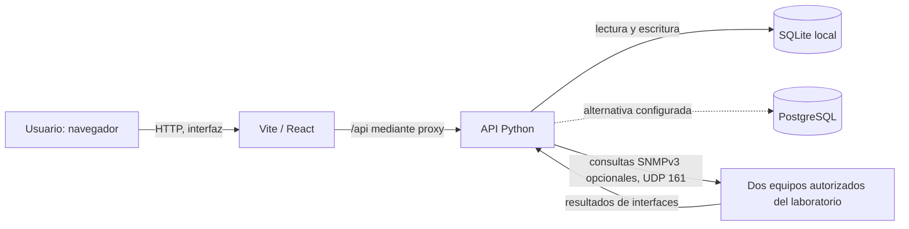

# Manual de instalación y despliegue — NetGuard AI

## 1. Información general

| Dato | Información |
|---|---|
| Nombre del proyecto | NetGuardAI |
| Nombre del sistema | NetGuard AI |
| Grupo | **Completar con el número de grupo** |
| Integrantes | **Completar con los nombres de los integrantes** |
| Curso y sección | **Completar con el curso y la sección** |
| Fecha de elaboración | 15 de noviembre de 2026 |
| Versión | 1.0.0 (versión declarada en `package.json`) |
| Repositorio GitHub | **Completar con la URL real del repositorio** |

Los datos académicos y el enlace del repositorio no están definidos en los
archivos disponibles del proyecto. Deben completarse antes de entregar este
manual; no se deben sustituir por información supuesta.

## 2. Descripción técnica de la solución

NetGuard AI es un prototipo local de monitoreo de red. `laptop.csv` es la fuente
única de dispositivos que aparecen en el dashboard. Solo presenta métricas,
alertas y lecturas que ya estén guardadas en la base de datos; no genera datos
ficticios. El monitor ICMP opcional realiza mediciones reales a los destinos
configurados. Cuando no hay mediciones para un equipo, se muestra como
**Sin métricas**. El índice de riesgo se calcula solo con lecturas SNMP de
tráfico comparables y recientes.

La aplicación tiene estos componentes:

- **Frontend:** interfaz de usuario en React, compilada y servida durante el
  desarrollo por Vite.
- **API:** servidor HTTP en Python que entrega el dashboard, consultas SNMPv3,
  mediciones ICMP periódicas y comprobaciones puntuales de exposición TCP.
- **Persistencia:** SQLite local por defecto. El backend también contempla
  PostgreSQL si se configura `DATABASE_URL` y se instala su driver.
- **Recolector SNMPv3 opcional:** consulta manualmente uno o más equipos privados
  autorizados del laboratorio; no requiere instalar un agente en esos equipos,
  pero tampoco realiza descubrimiento ni escaneo de laptops o de la red.
- **Comprobación de exposición:** revisa puertos conocidos de una sola IPv4
  privada por solicitud y requiere confirmar autorización. No explota servicios
  ni confirma vulnerabilidades o versiones.

### Diagrama de arquitectura



En desarrollo, el navegador abre el frontend en `127.0.0.1:5173` normalmente.
El proxy de Vite reenvía `/api` a la API Python, que escucha en `127.0.0.1` y
elige un puerto libre desde el 8000. La API puede seleccionar otro puerto si el
8000 está ocupado; `npm run dev` configura el proxy con el puerto seleccionado.
Ambos servicios están enlazados a la interfaz local y no se publican en la red
por defecto.

## 3. Tecnologías utilizadas

| Componente | Tecnología / versión |
|---|---|
| Lenguaje de frontend | JavaScript (módulos ES) |
| Interfaz | React 18.3.1 |
| Servidor y empaquetador web | Vite 6.0.5 |
| Backend | Python 3.10 o posterior; biblioteca estándar `http.server` |
| Base de datos predeterminada | SQLite (módulo estándar de Python) |
| Base de datos opcional | PostgreSQL, mediante `psycopg2-binary` 2.9.x |
| Recolección SNMPv3 opcional | PySNMP 7.x |
| Dependencias opcionales Python adicionales | `cryptography` 42 o posterior |
| Herramientas de ejecución | Node.js 20 o posterior, npm, Python y pip |
| Servicios externos para dashboard | Ninguno |

Las versiones de las dependencias JavaScript se fijan en `package-lock.json`.
Los rangos Python están declarados en `requirements.txt`. No se proporciona
una imagen de contenedor ni una configuración de alojamiento en la nube.

## 4. Requisitos para instalar y desplegar

### Requisitos de software

- Sistema operativo de escritorio o servidor con Node.js 20 o posterior y
  Python 3.10 o posterior. Se recomienda Linux para seguir literalmente los
  comandos de esta guía.
- npm incluido con Node.js y `venv`/`pip` de Python.
- Git para clonar el repositorio.
- Navegador web actualizado.
- Conexión a Internet para clonar el código y descargar dependencias durante
  la instalación.

### Hardware y recursos

Como referencia para el prototipo local: procesador de 2 núcleos, 4 GB de RAM
y al menos 1 GB de espacio disponible para código, dependencias y datos. Son
valores recomendados para una instalación de desarrollo, no resultados de una
prueba de carga ni requisitos de producción. El espacio requerido aumenta con
el historial persistido.

### Puertos, red y dependencias

| Uso | Puerto / requisito |
|---|---|
| Frontend Vite | 5173 normalmente; si está ocupado, Vite puede elegir otro |
| API Python | Desde 8000, intentando hasta 25 puertos consecutivos |
| SQLite | Archivo local `backend/netguard.sqlite3`; no requiere servicio de red |
| PostgreSQL opcional | Acceso al host y puerto configurados en `DATABASE_URL` |
| SNMPv3 opcional | Acceso UDP saliente al puerto 161 de cada equipo configurado |

El dashboard usa SQLite local por defecto. No se necesita PostgreSQL, SNMP ni
otro servicio externo para mostrar el inventario. La aplicación no requiere
abrir puertos en el router. En su configuración predeterminada solo acepta
conexiones locales (`127.0.0.1`).

### Inventario de red sin SNMPv3

El archivo de inventario principal es `laptop.csv`, con las columnas
`ip,name,type` y una fila por equipo. Estas columnas ya corresponden a los
campos de `public.devices`; no es necesario cambiar su estructura. Al iniciar,
la API sincroniza esas filas con la tabla `devices`.

Para consultar un inventario sin instalar agentes en las laptops ni configurar
SNMPv3, exporte la lista de concesiones activas desde el router o servidor DHCP
de la red y cárguela en **Inventario LAN**. El CSV debe incluir una columna
`ip`; admite opcionalmente `name`, `mac` y `type`. También reconoce encabezados
comunes como `IP Address`, `Hostname` y `MAC Address`. Solo se aceptan IPv4
privadas, hasta 1 MB y 1000 filas. Cada carga reemplaza la instantánea anterior.

Esta función **importa los datos que ya conoce el router/DHCP**; no sondea la
red, no descubre equipos con IP estática que no aparezcan en la exportación y
no obtiene métricas de tráfico. En la interfaz solo se muestran datos DHCP de
IPs que también estén en `laptop.csv`. El formato y la opción de exportación
dependen del fabricante del router o del servidor DHCP. No presente este
inventario como un escaneo activo.

SNMPv3 sigue disponible opcionalmente para leer interfaces de uno o más equipos
configurados. No es requisito para abrir el dashboard, simular observaciones ni
importar el inventario DHCP.

### 2. Comprobación manual por IP

En **Revisión de equipos**, este paso sigue al análisis CSV. Introduzca la IPv4
privada de un equipo propio o expresamente autorizado y confirme la
autorización. **Comprobar si responde** envía una única solicitud ICMP a esa IP
privada. Una respuesta confirma que el equipo respondió; la ausencia de
respuesta no demuestra que la IP no exista, porque el equipo o la red pueden
bloquear ICMP. Este resultado es una comprobación puntual, no un descubrimiento
de rangos ni un inventario de la red.

**Comprobar exposición** solo comprueba conexiones TCP a una lista fija de siete
puertos conocidos; no acepta rangos, IPs públicas, instrucciones arbitrarias,
credenciales ni cargas de explotación. Los servicios detectados son indicios
para revisar la configuración, no vulnerabilidades confirmadas. La ausencia de
respuestas no demuestra que el dispositivo esté libre de vulnerabilidades. El
botón **Recomprobar y analizar con IA** vuelve a comprobar esa única IP y pide
a Ollama explicar la exposición observada. Como no obtiene versiones de software
ni datos CVE, el análisis no confirma vulnerabilidades.

### Variables de entorno

Los scripts de inicio cargan automáticamente el archivo local `.env`, que está
excluido de Git. También se pueden definir variables en el entorno del proceso.

| Variable | Uso | Valor predeterminado / formato |
|---|---|---|
| `PYTHON` | Ejecutable Python usado por los scripts Node | `.venv/bin/python` si existe; si no, `python3` |
| `HOST` | Interfaz de escucha de la API | `127.0.0.1` |
| `PORT` | Puerto inicial de la API | `8000`; puede elegir un puerto disponible posterior |
| `VITE_HOST` | Interfaz de escucha del frontend | `127.0.0.1` |
| `VITE_API_PORT` | Puerto de la API para el proxy Vite | `8000`; `npm run dev` lo define automáticamente |
| `DATABASE_URL` | Conexión opcional a PostgreSQL | No definida; SQLite se usa por defecto |
| `OLLAMA_URL` | URL del endpoint local de Ollama | `http://127.0.0.1:11434/api/chat` |
| `OLLAMA_MODEL` | Modelo local que usará el análisis | `qwen2.5:3b` |
| `SNMP_DEVICES` | Lista JSON de equipos SNMPv3 autorizados incluidos en `laptop.csv` | Opcional; una o más IPv4 privadas |
| `PING_TARGETS` | Lista JSON que asocia cada dispositivo de `laptop.csv` con su destino ICMP privado | Opcional; sin configurar, el monitor ICMP queda deshabilitado |
| `PING_INTERVAL_SECONDS` | Intervalo entre mediciones ICMP | `60`; admite valores de 30 a 3600 segundos |
| `SNMPV3_USERNAME` | Usuario SNMPv3 | Configurado localmente en `.env` cuando se habilita SNMPv3 |
| `SNMPV3_AUTH_PASSWORD` | Clave de autenticación SNMPv3 | Configurada localmente en `.env`; mínimo 8 caracteres |
| `SNMPV3_PRIV_PASSWORD` | Clave de privacidad SNMPv3 | Configurada localmente en `.env`; mínimo 8 caracteres |
| `SNMPV3_AUTH_PROTOCOL` | Protocolo de autenticación | `SHA`, configurado localmente en `.env` |
| `SNMPV3_PRIV_PROTOCOL` | Protocolo de privacidad | `AES-128`, configurado localmente en `.env` |

No agregue contraseñas, tokens ni claves reales al repositorio, a este manual
ni a capturas de pantalla.

## 5. Instalación y configuración

Los pasos siguientes están escritos para Linux/macOS con una terminal tipo
Bash. Use la URL real del repositorio al reemplazar el marcador del comando.

### 5.1 Clonar el repositorio

```bash
git clone https://github.com/ORGANIZACION/REPOSITORIO.git
cd NetGuardAI
```

**Resultado esperado:** la carpeta contiene `package.json`, `package-lock.json`,
`requirements.txt`, `backend/` y `src/`. Sustituya `ORGANIZACION/REPOSITORIO`
por la dirección publicada por el equipo.

### 5.2 Verificar herramientas

```bash
node --version
npm --version
python3 --version
git --version
```

**Resultado esperado:** Node.js informa versión 20 o posterior y Python
informa versión 3.10 o posterior. Si `python3` no está disponible, instale
Python y `venv` para su sistema antes de continuar.

### 5.3 Crear el entorno Python e instalar dependencias

```bash
python3 -m venv .venv
source .venv/bin/activate
python -m pip install --upgrade pip
python -m pip install -r requirements.txt
```

**Resultado esperado:** se crea `.venv/` y pip instala las dependencias de
`requirements.txt` sin errores. El proyecto detecta automáticamente el
intérprete `.venv/bin/python`. Para consultar únicamente el dashboard, estas
dependencias Python de terceros no son necesarias; sí se requieren PySNMP y
sus dependencias para usar SNMP, y `psycopg2-binary` para PostgreSQL.

### 5.4 Instalar dependencias del frontend

```bash
npm ci
```

**Resultado esperado:** npm instala las dependencias definidas en
`package-lock.json` y crea `node_modules/`.

### 5.5 Base de datos

No se requiere crear la base de datos a mano. Al iniciar la API, esta crea el
esquema SQLite en `backend/netguard.sqlite3` y sincroniza los dispositivos
incluidos en `laptop.csv`. No agrega métricas ni eventos de demostración, y no
borra métricas, eventos ni dispositivos que ya existan. Solo los dispositivos
del CSV se muestran en la interfaz; el historial de los demás permanece guardado.
No hay un comando separado de migraciones ni scripts SQL iniciales que ejecutar.
El archivo de SQLite está excluido del control de versiones; cada instalación
nueva lo genera localmente. La carpeta `backend/` debe permitir escritura al
usuario que ejecuta la API.

PostgreSQL es opcional: requiere un servidor ya instalado y accesible, una base
de datos creada y `psycopg2-binary` instalado (incluido en `requirements.txt`).
Defina `DATABASE_URL` en el entorno del proceso con el URI de conexión de esa
base. El backend crea el esquema al arrancar. No escriba el URI con credenciales
reales en el repositorio o en un archivo versionado.

### 5.6 Configurar Ollama (opcional)

Instale Ollama desde <https://ollama.com/download>. El análisis se ejecuta en
el equipo local y no requiere una clave de API ni una cuenta de proveedor. El
modelo predeterminado es `qwen2.5:3b`; descargue sus archivos una vez:

```bash
ollama pull qwen2.5:3b
npm run dev
```

Ollama debe estar ejecutándose mientras uses NetGuard AI. En sistemas donde
Ollama no se inicia automáticamente, ejecuta `ollama serve` en otra terminal y
luego inicia la aplicación. Para usar otro modelo, descárgalo con `ollama pull`
y define `OLLAMA_MODEL` en la terminal que ejecuta el backend. El paso
**1. Análisis de dispositivos desde CSV** lee los dispositivos de `laptop.csv`
y los correlaciona por IP exacta con las métricas, alertas y lecturas guardadas.
Si el CSV solo incluye IP, nombre y tipo, y no hay telemetría para un equipo,
el análisis debe indicar que su riesgo no puede determinarse; no es una
evaluación de vulnerabilidades. El contenido se envía al servicio local de
Ollama. Sus respuestas no confirman intrusiones ni compromisos reales.

### 5.7 Configurar SNMPv3 (opcional)

Omita esta sección si no usará SNMPv3. Para habilitarlo, configure `SNMP_DEVICES`
con uno o más equipos de `laptop.csv`. La presencia en ese archivo no garantiza
que tengan SNMPv3 habilitado: verifique que sean equipos autorizados y que
respondan por UDP/161. Cree en cada uno un usuario SNMPv3 con autenticación
SHA o SHA-256 y privacidad AES-128, y permita las consultas desde la estación
donde corre NetGuard AI.

El nombre de usuario, protocolos y claves están configurados en el `.env`
local, que está excluido de Git y tiene permisos restringidos. Confirme que las
credenciales coincidan con las configuradas en los agentes SNMPv3 de los
equipos. Reinicie `npm run dev` después de cambiar ese archivo. No pase claves
como argumentos de línea de comandos, donde podrían quedar en el historial o
visibles en la lista de procesos.

**Resultado esperado:** la interfaz puede solicitar una consulta SNMPv3. Una
lectura exitosa muestra el tráfico de entrada y salida, errores y descartes
por interfaz, y los guarda en la misma base de datos. El tráfico por minuto se
calcula al comparar dos lecturas; la primera solo establece los contadores base.
Si un equipo no responde, compruebe su configuración, conectividad, protocolo y
reglas de firewall. En **Revisión de equipos**, también puede marcar
la autorización y pulsar **Analizar puertos y riesgos con IA**. Esa acción
comprueba una lista fija de puertos TCP únicamente en los equipos privados
de `SNMP_DEVICES`, y Ollama explica la exposición junto con las últimas lecturas
SNMP disponibles. No identifica CVE ni confirma vulnerabilidades.

El **Network Risk Index** compara el tráfico por interfaz con una lectura
anterior usada como línea base. Un aumento de al menos 50%, 100% o 200% suma
25, 50 o 100 puntos, respectivamente. La anomalía debe aparecer en dos
consultas consecutivas; la línea base y las consultas comparadas deben estar
dentro de las últimas 24 horas. El índice de red toma el máximo de las
interfaces y dispositivos evaluables; no usa eventos ni métricas de rendimiento.
Sin línea base o consultas suficientes, la tarjeta informa que faltan datos
comparables.

### 5.8 Medición periódica ICMP (opcional)

Si `PING_TARGETS` está configurado, al iniciar el backend NetGuard AI realiza
cinco solicitudes ICMP al destino privado asociado a cada equipo y guarda
latencia promedio, porcentaje de respuestas perdidas y disponibilidad. La
medición se repite cada
`PING_INTERVAL_SECONDS`; el dashboard se actualiza automáticamente cada minuto.
`device_ip` debe existir en `laptop.csv`, mientras que `target_ip` debe ser una
IPv4 privada autorizada. Si `PING_TARGETS` no está definido, el monitor queda
deshabilitado; no se generan mediciones ficticias.

Estas consultas miden respuestas ICMP reales; no provocan pérdida
deliberadamente. Si el destino o un firewall bloquea ICMP, la pérdida observada
no demuestra por sí sola que el resto del tráfico de red esté fallando. El
monitor no mide tráfico en MB/min ni crea alertas.

## 6. Ejecución y despliegue

### 6.1 Iniciar el sistema local

Desde la raíz del proyecto, con las variables opcionales configuradas en esa
misma terminal:

```bash
npm run dev
```

**Resultado esperado:** se inicia el backend Python y Vite. La terminal muestra
la dirección local del frontend y los registros de la API. Abra la dirección
que Vite indique, normalmente <http://127.0.0.1:5173>. Mantenga la terminal
abierta mientras use el sistema. `Ctrl+C` detiene ambos servicios.

Los puertos pueden variar si los predeterminados están ocupados. Use las
direcciones impresas por los procesos. El script de desarrollo selecciona un
puerto libre de API desde 8000 hasta 8024 y configura el proxy del frontend.

#### Permitir acceso desde la red local

Para una demostración en una LAN de confianza, ejecute Vite escuchando en
todas las interfaces de red. Desde la raíz del proyecto:

```bash
VITE_HOST=0.0.0.0 npm run dev
```

La API continúa escuchando solo en `127.0.0.1`; el frontend de Vite reenvía las
solicitudes `/api` localmente. En la otra computadora no se instala NetGuard
AI: basta con un navegador conectado a la misma red.

Obtenga la IPv4 de la computadora que ejecuta NetGuard AI (en Linux, por
ejemplo, con `hostname -I`) y desde los demás equipos abra
`http://IP-DEL-SERVIDOR:5173`, sustituyendo el marcador por esa dirección. Si
Vite indica otro puerto porque el 5173 está ocupado, use ese puerto. Si no
carga, compruebe que ambas computadoras estén en la misma red y permita ese
puerto TCP en el firewall del servidor, limitado a la subred local cuando sea
posible.

**Seguridad:** esta configuración es solo para una demostración en una red
confiable. La aplicación no tiene autenticación ni TLS; cualquier equipo con
acceso a la página puede interactuar con ella y generar cambios en los datos.
No la exponga a Internet ni a redes públicas. Para uso compartido persistente o
en una red no confiable, primero hace falta un despliegue con autenticación,
HTTPS y controles de acceso.

### 6.2 Iniciar solo la API

```bash
npm run server
```

La API escucha localmente desde el puerto 8000, seleccionando otro puerto
disponible si hace falta. Este comando no inicia el frontend.

### 6.3 Construir el frontend

```bash
npm run build
```

**Resultado esperado:** Vite termina sin errores y genera los archivos estáticos
en `dist/`. Esta construcción solo genera el frontend; no configura un
despliegue público ni sustituye a la API. Para una prueba local con ambos
componentes, utilice `npm run dev`.

Este repositorio no incluye una configuración de servidor web, TLS,
autenticación ni despliegue en nube. No se debe exponer directamente a Internet
como si fuera un servicio de producción. Para un despliegue remoto se requiere
diseñar y asegurar por separado el alojamiento del frontend y la API, el
enrutamiento `/api`, el acceso a la base de datos, la gestión de secretos y el
control de acceso.

## 7. Verificación del funcionamiento

Con `npm run dev` en ejecución:

1. **Inicio:** confirme en la terminal que Vite y la API arrancaron sin errores.
2. **Acceso web:** abra la URL local impresa por Vite; debe mostrarse el
   dashboard de NetGuard AI.
3. **API y proxy:** desde otra terminal, reemplace `5173` si Vite informó otro
   puerto:

   ```bash
   curl -i http://127.0.0.1:5173/api/health
   ```

   **Resultado esperado:** HTTP `200` y un JSON similar a
   `{"status":"ok","mode":"inventario_csv"}`.

4. **Dashboard y base de datos:** ejecute:

   ```bash
   curl -i http://127.0.0.1:5173/api/dashboard
   ```

   **Resultado esperado:** HTTP `200`, JSON con resumen, dispositivos, alertas
   y `database` con valor `SQLite` (o `PostgreSQL` si se configuró la alternativa).
   Debe existir `backend/netguard.sqlite3` cuando SQLite está en uso.

5. **Inventario:** confirme que la tabla muestra únicamente las IP de
   `laptop.csv`. Sin métricas reales guardadas, los equipos deben indicar
   **Sin métricas** y las alertas deben estar vacías. El índice de riesgo solo
   muestra una puntuación tras consultas SNMP comparables suficientes.

6. **Pruebas automatizadas y compilación:** detenga o mantenga el servidor y
   ejecute en la raíz:

   ```bash
   npm run test:api
   npm run build
   ```

   **Resultado esperado:** las pruebas Python terminan con `OK` y la
   construcción de Vite finaliza sin errores.

7. **Revisión de equipos en orden:** use la sección **Revisión de equipos** y
   siga sus pasos en orden:
   1. **CSV:** pulse **Analizar laptop.csv**. **Resultado esperado:** aparece el
      análisis de riesgo basado en los equipos y datos disponibles; no confirma
      vulnerabilidades.
   2. **IP manual:** en **2. Comprobación manual por IP**, indique una IPv4
      privada autorizada y pulse **Comprobar si responde**. Una respuesta
      confirma que contestó; la ausencia de respuesta no demuestra que la IP no
      exista. **Comprobar exposición** muestra los puertos revisados y
      recomendaciones; no se intenta iniciar sesión ni explotar servicios.
      Para una explicación de IA, pulse
      **Recomprobar y analizar con IA**; esta acción vuelve a revisar esa IP.
   3. **SNMPv3:** después de configurar las variables y equipos, pulse
      **Consultar SNMPv3** en **3. Consulta de dispositivos mediante SNMPv3**.
      **Resultado esperado:** aparecen lecturas de interfaces. Las IP
      configuradas deben existir en `laptop.csv`. Si no configuró SNMP, omita
      este paso. Para revisar
      también los puertos de los equipos configurados, confirme la autorización y pulse
      **Analizar puertos y riesgos con IA**. Solo se evalúa la lista fija de
      puertos TCP y no se confirman CVE.
8. **Inventario DHCP opcional:** en **Inventario LAN**, cargue un CSV exportado
   desde el router o servidor DHCP con una columna `ip` (y, opcionalmente,
   `name`, `mac`, `type`). Solo se muestran filas cuya IP también figure en
   `laptop.csv`; la importación no agrega dispositivos al dashboard ni sondea
   equipos.

Como evidencia de entrega, capture el inventario real, la respuesta exitosa de
`/api/health` y la ejecución de pruebas/build. En las capturas,
oculte direcciones o cualquier información sensible del laboratorio y no
incluya claves.

## 8. Solución de problemas frecuentes

| Problema | Posible causa | Solución |
|---|---|---|
| `node`, `npm` o `python3` no se encuentra | Herramienta ausente o no está en `PATH` | Instale Node.js 20+ y Python 3.10+; cierre y vuelva a abrir la terminal y repita los comandos de versión. |
| `npm ci` falla | No hay conexión al registro npm, versión de Node incompatible o instalación interrumpida | Verifique la conexión y las versiones; vuelva a ejecutar `npm ci` desde la carpeta que contiene `package-lock.json`. |
| Error al crear el entorno virtual | Falta el componente `venv`/`ensurepip` de la instalación Python | Instale el paquete de entornos virtuales de su distribución y repita la creación del entorno. |
| La interfaz indica que no se conecta con la API | Se inició solo Vite, el backend terminó o se abrió una URL/puerto distinto | Inicie `npm run dev`, mantenga la terminal abierta y use la URL que imprime Vite. |
| No se puede iniciar porque el puerto está ocupado | Otro proceso utiliza un puerto local | Detenga el proceso propio que lo ocupa o use el puerto alternativo indicado por Vite/API. La API busca entre 8000 y 8024. |
| No se crea o actualiza SQLite | El usuario no puede escribir en `backend/` o el disco no tiene espacio | Ejecute el proyecto desde una carpeta con permisos de escritura y compruebe el espacio disponible. |
| Error al conectar con PostgreSQL | `DATABASE_URL` incorrecta, servidor inaccesible o falta el driver | Compruebe host, puerto, base de datos y permisos; instale `requirements.txt` y mantenga el URI fuera del repositorio. |
| SNMP informa que falta configuración o que `SNMP_DEVICES` no es válido | Faltan variables, JSON incorrecto o IPs fuera de `laptop.csv` | Revise el formato JSON y configure uno o más equipos privados incluidos en `laptop.csv`; vuelva a exportar las variables en la terminal que inicia la API. |
| SNMP no obtiene respuesta del equipo | UDP/161 bloqueado, equipo inaccesible o credenciales/protocolos no coinciden | Verifique conectividad desde el servidor, firewall, usuario SNMPv3 y protocolos configurados en el equipo. Use solo equipos autorizados. |
| Las consultas SNMP fallan con `Falta PySNMP` | Dependencias Python opcionales no instaladas en el entorno activo | Active `.venv` y ejecute `python -m pip install -r requirements.txt`; después reinicie `npm run dev`. |
| El puerto SNMP responde pero no hay interfaces | El agente no expone las tablas MIB consultadas o sus permisos son insuficientes | Habilite las vistas SNMPv3 necesarias de sistema e interfaces en el equipo y vuelva a consultar. |
| El panel ICMP no muestra datos | `PING_TARGETS` inválido, destino no privado, `device_ip` ausente del CSV o falta `ping` | Revise el JSON, instale `iputils-ping` si hace falta y reinicie `npm run dev`. |

## 9. Límites conocidos

- Solo aparecen como dispositivos monitoreados las IP de `laptop.csv`.
- El índice de riesgo requiere una lectura SNMP previa como línea base y dos
  consultas consecutivas comparables, todas dentro de las últimas 24 horas. La
  consulta SNMP es manual, por lo que las lecturas pueden quedar obsoletas; el
  índice no usa eventos ni métricas de rendimiento.
- El recolector SNMPv3 es una opción manual para los equipos configurados; no
  descubre ni escanea laptops y no reemplaza una integración de monitoreo
  continuo.
- La pérdida ICMP se mide desde el equipo que ejecuta el backend hacia cada
  destino configurado; no equivale a pérdida de todo tipo de tráfico ni fuerza
  fallos de red.
- El inventario DHCP refleja solo los equipos incluidos en el último archivo
  importado; no detecta activos fuera de esa exportación ni mide su tráfico.
- La comprobación de exposición solo verifica conectividad TCP a una lista
  pequeña de puertos en un equipo privado; no realiza un análisis de CVE,
  versiones, configuración autenticada ni explotación.
- La aplicación está configurada para uso local y no proporciona controles de
  seguridad suficientes para un despliegue público o de producción.
