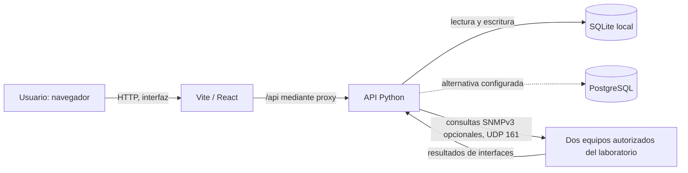

# Manual de instalación y despliegue — NetGuard AI

## 1. Información general

| Dato | Información |
|---|---|
| Nombre del proyecto | NetGuardAI |
| Nombre del sistema | NetGuard AI |
| Grupo | **Completar con el número de grupo** |
| Integrantes | **Completar con los nombres de los integrantes** |
| Curso y sección | **Completar con el curso y la sección** |
| Fecha de elaboración | 15 de noviembre de 2026 |
| Versión | 1.0.0 (versión declarada en `package.json`) |
| Repositorio GitHub | **Completar con la URL real del repositorio** |

Los datos académicos y el enlace del repositorio no están definidos en los
archivos disponibles del proyecto. Deben completarse antes de entregar este
manual; no se deben sustituir por información supuesta.

## 2. Descripción técnica de la solución

NetGuard AI es un prototipo local de monitoreo de red. Presenta métricas,
alertas y una topología de demostración en una interfaz web. En el modo
predeterminado utiliza información sintética; el botón **Simular observación**
genera y persiste una observación ficticia. La detección y el índice de riesgo
son demostrativos, no un modelo de aprendizaje automático entrenado.

La aplicación tiene estos componentes:

- **Frontend:** interfaz de usuario en React, compilada y servida durante el
  desarrollo por Vite.
- **API:** servidor HTTP en Python que entrega el dashboard, registra
  simulaciones y, opcionalmente, inicia consultas SNMPv3.
- **Persistencia:** SQLite local por defecto. El backend también contempla
  PostgreSQL si se configura `DATABASE_URL` y se instala su driver.
- **Recolector SNMPv3 opcional:** consulta manualmente dos equipos privados
  autorizados del laboratorio; no realiza descubrimiento ni escaneo de red.

### Diagrama de arquitectura



En desarrollo, el navegador abre el frontend en `127.0.0.1:5173` normalmente.
El proxy de Vite reenvía `/api` a la API Python, que escucha en `127.0.0.1` y
elige un puerto libre desde el 8000. La API puede seleccionar otro puerto si el
8000 está ocupado; `npm run dev` configura el proxy con el puerto seleccionado.
Ambos servicios están enlazados a la interfaz local y no se publican en la red
por defecto.

## 3. Tecnologías utilizadas

| Componente | Tecnología / versión |
|---|---|
| Lenguaje de frontend | JavaScript (módulos ES) |
| Interfaz | React 18.3.1 |
| Servidor y empaquetador web | Vite 6.0.5 |
| Backend | Python 3.10 o posterior; biblioteca estándar `http.server` |
| Base de datos predeterminada | SQLite (módulo estándar de Python) |
| Base de datos opcional | PostgreSQL, mediante `psycopg2-binary` 2.9.x |
| Recolección SNMPv3 opcional | PySNMP 7.x |
| Dependencias opcionales Python adicionales | `cryptography` 42 o posterior |
| Herramientas de ejecución | Node.js 20 o posterior, npm, Python y pip |
| Servicios externos en modo demo | Ninguno |

Las versiones de las dependencias JavaScript se fijan en `package-lock.json`.
Los rangos Python están declarados en `requirements.txt`. No se proporciona
una imagen de contenedor ni una configuración de alojamiento en la nube.

## 4. Requisitos para instalar y desplegar

### Requisitos de software

- Sistema operativo de escritorio o servidor con Node.js 20 o posterior y
  Python 3.10 o posterior. Se recomienda Linux para seguir literalmente los
  comandos de esta guía.
- npm incluido con Node.js y `venv`/`pip` de Python.
- Git para clonar el repositorio.
- Navegador web actualizado.
- Conexión a Internet para clonar el código y descargar dependencias durante
  la instalación.

### Hardware y recursos

Como referencia para el prototipo local: procesador de 2 núcleos, 4 GB de RAM
y al menos 1 GB de espacio disponible para código, dependencias y datos. Son
valores recomendados para una instalación de desarrollo, no resultados de una
prueba de carga ni requisitos de producción. El espacio requerido aumenta con
el historial persistido.

### Puertos, red y dependencias

| Uso | Puerto / requisito |
|---|---|
| Frontend Vite | 5173 normalmente; si está ocupado, Vite puede elegir otro |
| API Python | Desde 8000, intentando hasta 25 puertos consecutivos |
| SQLite | Archivo local `backend/netguard.sqlite3`; no requiere servicio de red |
| PostgreSQL opcional | Acceso al host y puerto configurados en `DATABASE_URL` |
| SNMPv3 opcional | Acceso UDP saliente al puerto 161 de cada equipo configurado |

Para el modo demo, no se necesita PostgreSQL, SNMP ni otro servicio externo.
La aplicación no requiere abrir puertos en el router. En su configuración
predeterminada solo acepta conexiones locales (`127.0.0.1`).

### Variables de entorno

No se necesita un archivo `.env`: el proyecto no carga automáticamente ese
formato. Las variables deben estar en el entorno del proceso que inicia la
aplicación.

| Variable | Uso | Valor predeterminado / formato |
|---|---|---|
| `PYTHON` | Ejecutable Python usado por los scripts Node | `.venv/bin/python` si existe; si no, `python3` |
| `HOST` | Interfaz de escucha de la API | `127.0.0.1` |
| `PORT` | Puerto inicial de la API | `8000`; puede elegir un puerto disponible posterior |
| `VITE_HOST` | Interfaz de escucha del frontend | `127.0.0.1` |
| `VITE_API_PORT` | Puerto de la API para el proxy Vite | `8000`; `npm run dev` lo define automáticamente |
| `DATABASE_URL` | Conexión opcional a PostgreSQL | No definida; SQLite se usa por defecto |
| `SNMP_DEVICES` | Lista JSON de los equipos SNMPv3 autorizados | Requerida solo al usar la consulta SNMP; exactamente dos IPv4 privadas |
| `SNMPV3_USERNAME` | Usuario SNMPv3 | Requerido solo para SNMP |
| `SNMPV3_AUTH_PASSWORD` | Clave de autenticación SNMPv3 | Requerida; mínimo 8 caracteres |
| `SNMPV3_PRIV_PASSWORD` | Clave de privacidad SNMPv3 | Requerida; mínimo 8 caracteres |
| `SNMPV3_AUTH_PROTOCOL` | Protocolo de autenticación | `SHA` por defecto; admite `SHA-256` |
| `SNMPV3_PRIV_PROTOCOL` | Protocolo de privacidad | `AES-128` por defecto; debe ser `AES-128` |

No agregue contraseñas, tokens ni claves reales al repositorio, a este manual
ni a capturas de pantalla.

## 5. Instalación y configuración

Los pasos siguientes están escritos para Linux/macOS con una terminal tipo
Bash. Use la URL real del repositorio al reemplazar el marcador del comando.

### 5.1 Clonar el repositorio

```bash
git clone https://github.com/ORGANIZACION/REPOSITORIO.git
cd NetGuardAI
```

**Resultado esperado:** la carpeta contiene `package.json`, `package-lock.json`,
`requirements.txt`, `backend/` y `src/`. Sustituya `ORGANIZACION/REPOSITORIO`
por la dirección publicada por el equipo.

### 5.2 Verificar herramientas

```bash
node --version
npm --version
python3 --version
git --version
```

**Resultado esperado:** Node.js informa versión 20 o posterior y Python
informa versión 3.10 o posterior. Si `python3` no está disponible, instale
Python y `venv` para su sistema antes de continuar.

### 5.3 Crear el entorno Python e instalar dependencias

```bash
python3 -m venv .venv
source .venv/bin/activate
python -m pip install --upgrade pip
python -m pip install -r requirements.txt
```

**Resultado esperado:** se crea `.venv/` y pip instala las dependencias de
`requirements.txt` sin errores. El proyecto detecta automáticamente el
intérprete `.venv/bin/python`. Para utilizar solamente el modo demo, estas
dependencias Python de terceros no son necesarias; sí se requieren PySNMP y
sus dependencias para usar SNMP, y `psycopg2-binary` para PostgreSQL.

### 5.4 Instalar dependencias del frontend

```bash
npm ci
```

**Resultado esperado:** npm instala las dependencias definidas en
`package-lock.json` y crea `node_modules/`.

### 5.5 Base de datos

No se requiere crear la base de datos a mano en el modo predeterminado. Al
iniciar la API, esta crea el esquema SQLite en
`backend/netguard.sqlite3` y agrega los registros de demostración si faltan.
No hay un comando separado de migraciones ni scripts SQL iniciales que ejecutar.
El archivo de SQLite está excluido del control de versiones; cada instalación
nueva lo genera localmente. La carpeta `backend/` debe permitir escritura al
usuario que ejecuta la API.

PostgreSQL es opcional: requiere un servidor ya instalado y accesible, una base
de datos creada y `psycopg2-binary` instalado (incluido en `requirements.txt`).
Defina `DATABASE_URL` en el entorno del proceso con el URI de conexión de esa
base. El backend crea el esquema al arrancar. No escriba el URI con credenciales
reales en el repositorio o en un archivo versionado.

### 5.6 Configurar SNMPv3 (opcional)

Omita esta sección si utilizará únicamente la demostración. Para consultas
reales, configure los dos equipos privados del laboratorio, cree en cada uno
un usuario SNMPv3 con autenticación SHA o SHA-256 y privacidad AES-128, y
autorice la estación donde corre NetGuard AI. Use solo equipos propios o
expresamente autorizados.

En la misma terminal que usará para iniciar la aplicación, ajuste las
direcciones y nombres a los equipos reales del laboratorio:

```bash
export SNMP_DEVICES='[{"name":"Equipo-Lab-1","ip":"192.168.10.10","type":"Switch"},{"name":"Equipo-Lab-2","ip":"192.168.10.11","type":"Router"}]'
export SNMPV3_AUTH_PROTOCOL=SHA
export SNMPV3_PRIV_PROTOCOL=AES-128
read -r -p "Usuario SNMPv3: " SNMPV3_USERNAME
export SNMPV3_USERNAME
read -r -s -p "Clave de autenticación SNMPv3: " SNMPV3_AUTH_PASSWORD
printf '\n'
export SNMPV3_AUTH_PASSWORD
read -r -s -p "Clave de privacidad SNMPv3: " SNMPV3_PRIV_PASSWORD
printf '\n'
export SNMPV3_PRIV_PASSWORD
```

Los nombres e IP anteriores son valores de ejemplo, no credenciales ni datos
de equipos reales. Sustituya las IP por las direcciones IPv4 privadas del
laboratorio; deben ser únicas y corresponder exactamente a dos equipos
alcanzables por UDP/161. Las claves se solicitan sin mostrarse en pantalla.
Al cerrar la terminal se pierden estas variables. No las guarde en el
repositorio ni comparta la terminal con las claves visibles.

**Resultado esperado:** la interfaz puede solicitar una consulta SNMPv3. Una
lectura exitosa muestra datos de interfaces y los guarda en la misma base de
datos. Si un equipo no responde, compruebe su configuración, conectividad,
protocolo y reglas de firewall.

## 6. Ejecución y despliegue

### 6.1 Iniciar el sistema local

Desde la raíz del proyecto, con las variables opcionales configuradas en esa
misma terminal:

```bash
npm run dev
```

**Resultado esperado:** se inicia el backend Python y Vite. La terminal muestra
la dirección local del frontend y los registros de la API. Abra la dirección
que Vite indique, normalmente <http://127.0.0.1:5173>. Mantenga la terminal
abierta mientras use el sistema. `Ctrl+C` detiene ambos servicios.

Los puertos pueden variar si los predeterminados están ocupados. Use las
direcciones impresas por los procesos. El script de desarrollo selecciona un
puerto libre de API desde 8000 hasta 8024 y configura el proxy del frontend.

### 6.2 Iniciar solo la API

```bash
npm run server
```

La API escucha localmente desde el puerto 8000, seleccionando otro puerto
disponible si hace falta. Este comando no inicia el frontend.

### 6.3 Construir el frontend

```bash
npm run build
```

**Resultado esperado:** Vite termina sin errores y genera los archivos estáticos
en `dist/`. Esta construcción solo genera el frontend; no configura un
despliegue público ni sustituye a la API. Para una prueba local con ambos
componentes, utilice `npm run dev`.

Este repositorio no incluye una configuración de servidor web, TLS,
autenticación ni despliegue en nube. No se debe exponer directamente a Internet
como si fuera un servicio de producción. Para un despliegue remoto se requiere
diseñar y asegurar por separado el alojamiento del frontend y la API, el
enrutamiento `/api`, el acceso a la base de datos, la gestión de secretos y el
control de acceso.

## 7. Verificación del funcionamiento

Con `npm run dev` en ejecución:

1. **Inicio:** confirme en la terminal que Vite y la API arrancaron sin errores.
2. **Acceso web:** abra la URL local impresa por Vite; debe mostrarse el
   dashboard de NetGuard AI.
3. **API y proxy:** desde otra terminal, reemplace `5173` si Vite informó otro
   puerto:

   ```bash
   curl -i http://127.0.0.1:5173/api/health
   ```

   **Resultado esperado:** HTTP `200` y un JSON similar a
   `{"status":"ok","mode":"simulado"}`.

4. **Dashboard y base de datos:** ejecute:

   ```bash
   curl -i http://127.0.0.1:5173/api/dashboard
   ```

   **Resultado esperado:** HTTP `200`, JSON con resumen, dispositivos, alertas
   y `database` con valor `SQLite` (o `PostgreSQL` si se configuró la alternativa).
   Debe existir `backend/netguard.sqlite3` cuando SQLite está en uso.

5. **Funcionalidad principal:** en la interfaz, pulse **Simular observación**.
   **Resultado esperado:** aparece una notificación de observación sintética,
   se actualiza la actividad del dashboard y el evento permanece al recargar la
   página.

6. **Pruebas automatizadas y compilación:** detenga o mantenga el servidor y
   ejecute en la raíz:

   ```bash
   npm run test:api
   npm run build
   ```

   **Resultado esperado:** las pruebas Python terminan con `OK` y la
   construcción de Vite finaliza sin errores.

7. **SNMPv3 opcional:** solo después de configurar las variables y los equipos,
   pulse **Consultar SNMPv3**. **Resultado esperado:** se muestra el número de
   equipos consultados y aparecen datos de interfaces. Si no configuró SNMP,
   no utilice esta verificación; la prueba demo no depende de SNMP.

Como evidencia de entrega, capture la interfaz con datos demo, la respuesta
exitosa de `/api/health` y la ejecución de pruebas/build. En las capturas,
oculte direcciones o cualquier información sensible del laboratorio y no
incluya claves.

## 8. Solución de problemas frecuentes

| Problema | Posible causa | Solución |
|---|---|---|
| `node`, `npm` o `python3` no se encuentra | Herramienta ausente o no está en `PATH` | Instale Node.js 20+ y Python 3.10+; cierre y vuelva a abrir la terminal y repita los comandos de versión. |
| `npm ci` falla | No hay conexión al registro npm, versión de Node incompatible o instalación interrumpida | Verifique la conexión y las versiones; vuelva a ejecutar `npm ci` desde la carpeta que contiene `package-lock.json`. |
| Error al crear el entorno virtual | Falta el componente `venv`/`ensurepip` de la instalación Python | Instale el paquete de entornos virtuales de su distribución y repita la creación del entorno. |
| La interfaz indica que no se conecta con la API | Se inició solo Vite, el backend terminó o se abrió una URL/puerto distinto | Inicie `npm run dev`, mantenga la terminal abierta y use la URL que imprime Vite. |
| No se puede iniciar porque el puerto está ocupado | Otro proceso utiliza un puerto local | Detenga el proceso propio que lo ocupa o use el puerto alternativo indicado por Vite/API. La API busca entre 8000 y 8024. |
| No se crea o actualiza SQLite | El usuario no puede escribir en `backend/` o el disco no tiene espacio | Ejecute el proyecto desde una carpeta con permisos de escritura y compruebe el espacio disponible. |
| Error al conectar con PostgreSQL | `DATABASE_URL` incorrecta, servidor inaccesible o falta el driver | Compruebe host, puerto, base de datos y permisos; instale `requirements.txt` y mantenga el URI fuera del repositorio. |
| SNMP informa que falta configuración o que `SNMP_DEVICES` no es válido | Faltan variables, JSON incorrecto o la lista no contiene exactamente dos equipos | Revise el formato JSON, los nombres y las dos IPv4 privadas distintas; vuelva a exportar las variables en la terminal que inicia la API. |
| SNMP no obtiene respuesta del equipo | UDP/161 bloqueado, equipo inaccesible o credenciales/protocolos no coinciden | Verifique conectividad desde el servidor, firewall, usuario SNMPv3 y protocolos configurados en el equipo. Use solo equipos autorizados. |
| Las consultas SNMP fallan con `Falta PySNMP` | Dependencias Python opcionales no instaladas en el entorno activo | Active `.venv` y ejecute `python -m pip install -r requirements.txt`; después reinicie `npm run dev`. |
| El puerto SNMP responde pero no hay interfaces | El agente no expone las tablas MIB consultadas o sus permisos son insuficientes | Habilite las vistas SNMPv3 necesarias de sistema e interfaces en el equipo y vuelva a consultar. |

## 9. Límites conocidos

- La base de datos y las métricas iniciales son locales y de demostración.
- La detección, las predicciones y el índice de riesgo son heurísticos y no
  prueban intrusiones ni compromisos.
- El recolector SNMPv3 es una opción manual para dos equipos configurados; no
  reemplaza una integración de monitoreo continuo.
- La aplicación está configurada para uso local y no proporciona controles de
  seguridad suficientes para un despliegue público o de producción.
